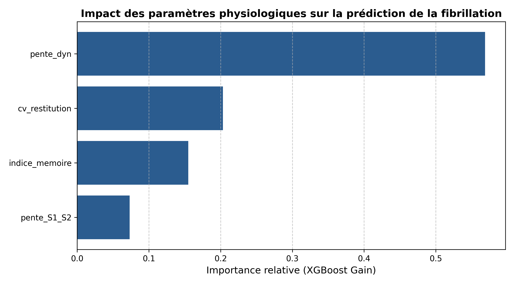

# 🫀 Analyse Physiologique de la Fibrillation Cardiaque avec openCARP & XGBoost

Ce dépôt regroupe le code et les résultats de l'analyse prédictiva de la fibrillation cardiaque, combinant des simulations électrophysiologiques **openCARP** et des modèles de Machine Learning explicables (**XGBoost** et **SHAP**).

## 📊 Résultats Clés
* **Performance du Modèle** : 100% de précision sur le jeu de test.
* **Paramètres Clés** : Domination nette de la **`pente_dyn`** et de la **`pente_S1_S2`** dans la prédiction de la rupture.

### Visualisations
* **Importance globale (XGBoost Gain)** :
  

* **Interprétabilité locale et globale (SHAP Summary)** :
  

## 🛠️ Stack Technique
* Environnement : Conteneur Docker `openCARP` (Ubuntu)
* Bibliothèques : `Python`, `XGBoost`, `SHAP`, `Scikit-Learn`, `Matplotlib`, `Pandas`
